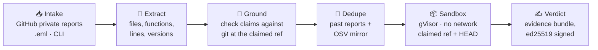

<div align="center">

# Kritolith

**Verify, dedupe, reproduce.**

Kritolith checks incoming security reports before a maintainer reads them.<br>
Today it tests every claim against the real code and flags duplicates, with the evidence for each.<br>
Reproducing the PoC in a locked-down sandbox and signing the verdict are next on the roadmap.

[](LICENSE)
[](#roadmap)
[](https://go.dev)
[](#privacy-and-llms)
[](CONTRIBUTING.md)

[Try it](#try-it) · [How it works](#how-it-works) · [Verdicts](#verdicts) · [Where it stands](#where-it-stands) · [Roadmap](#roadmap) · [Contributing](CONTRIBUTING.md) · [Security](SECURITY.md)

</div>

> [!WARNING]
> **Kritolith is pre-alpha.** `kritolith check` works today for Go projects: it extracts the claims in a report, checks them against the repository at the claimed commit, and looks for duplicates. It does **not** run PoC code yet, so it cannot say whether a report reproduces. Keep it away from real embargoed reports until the [threat model](#roadmap) and sandbox hardening land.

## Try it

You need Go 1.26 or later and `git`. No LLM, no container runtime, no configuration file.

```sh
go install github.com/ergasterion-dev/kritolith/cmd/kritolith@latest

git clone https://github.com/ergasterion-dev/kritolith && cd kritolith
kritolith check --repo golang/net --ref e1fcd82abba34df74614020343be8eb1fe85f0d9 \
  testdata/corpus/fabricated/fab-001-invented-method/report.md
```

That report describes an out-of-bounds read in a method called `(*Framer).ReadContinuationUnsafe`. The method was invented for the test corpus. Kritolith fetches `golang/net`, looks at the claimed commit, and answers:

```text
Kritolith: GROUNDING_FAILED at e1fcd82abba3
• file http2/frame.go — file exists at e1fcd82abba3
• function (*Framer).ReadContinuationUnsafe — not declared in the repository; closest match: parseContinuationFrame (http2/frame.go:1257)
• version v0.38.0 — found in report text; not yet checked against code
• a claimed file or function does not exist at the resolved commit
```

The first run clones the repository into a local mirror; later runs on the same repository take about half a second. Add `--json` for machine-readable output.

A real advisory gets a different answer. Run it on `testdata/corpus/real/go-2024-3250/report.md` (`--repo golang-jwt/jwt --ref 9358574a7a1a2c8d644f22b6e8de627ba85c58d0`) and the claimed function is found at `parser.go:52`; the verdict is `INCONCLUSIVE` because reproducing the PoC is the part that is not built yet.

---

## Why

Maintainers are buried in security reports. Many cite files or functions that don't exist, many are duplicates of each other, and refuting a single fake one can take hours. The harder problem now is volume: too many *credible-looking* reports and not enough maintainer time.

Kritolith does the tedious first pass so you only spend time on reports that survived it. **It never makes the decision for you.** Every verdict comes with the evidence behind it, and humans decide what happens next.

## How it works



| Stage | What it does |
|---|---|
| **Intake** | Receives reports from GitHub private vulnerability reporting, piped `.eml` messages, or a local file. |
| **Extract** | Pulls out concrete claims: file paths, `pkg.Func` names, `file.go:123` lines, versions, commit SHAs, PoC code. Deterministic parsing first; an optional LLM fills gaps with strictly validated JSON. |
| **Ground** | Checks out the claimed commit and verifies each claim with `git` and Go's own parser. *Does `http2.parseHeader` actually exist at `a3f9c1`?* |
| **Dedupe** | Compares against earlier reports (fingerprints + embeddings) and a local mirror of the [OSV](https://osv.dev) Go advisory database. |
| **Sandbox** | Builds and runs the PoC under [gVisor](https://gvisor.dev) with no network, hard CPU/memory/PID limits, and a control run at `HEAD`. |
| **Verdict** | Writes a short, factual verdict plus an evidence bundle signed with ed25519, so anyone can check it wasn't altered. |

**Built today:** intake from a local file, extract, ground, dedupe. **Not built yet:** intake from GitHub private reports and `.eml`, the sandbox, and signing. See [Roadmap](#roadmap).

## Verdicts

| Outcome | Meaning |
|---|---|
| 🟥 `REPRODUCED` | The PoC triggered the claimed behavior at the claimed commit. |
| 🟧 `REPRODUCED_FIXED_AT_HEAD` | Reproduces at the claimed commit but not at `HEAD`. Probably already fixed. |
| ⬜ `NOT_REPRODUCED` | The PoC ran cleanly and the claimed behavior was not observed. |
| 🟪 `GROUNDING_FAILED` | A hard claim (a file or function) provably doesn't exist at the claimed commit. |
| 🟦 `LIKELY_DUPLICATE` | Strong match to an earlier report or a published advisory. Shown alongside the repro result. |
| 🟨 `NEEDS_INFO` | No runnable PoC, or no identifiable commit or version. |
| ⬛ `INCONCLUSIVE` | Build failure, timeout, sandbox error, or anything ambiguous. |

> [!IMPORTANT]
> **Kritolith is built never to wrongly reject a real report.** Line numbers drift, so a wrong line alone never causes `GROUNDING_FAILED`. When the evidence is unclear, the answer is `INCONCLUSIVE`, not a rejection.

## Design principles

- **Deterministic checks decide.** The LLM only extracts claims and drafts replies. Everything it produces is re-verified against git or the sandbox.
- **Every report is hostile input.** Report text, PoC code and attachments are assumed to contain prompt injection or sandbox escape attempts.
- **Evidence, not opinions.** Each claim records what was found, where, and at which commit.
- **One static binary.** Standard library first. The only third-party Go module is a pure-Go SQLite driver. No vendor SDKs.

## Privacy and LLMs

Security reports describe unfixed vulnerabilities, so Kritolith is **local-first**:

- It works with **no LLM at all**, using deterministic extraction only.
- It supports local models through any OpenAI-compatible server: [Ollama](https://ollama.com), llama.cpp, vLLM, LM Studio.
- Cloud providers (OpenAI, Anthropic, Gemini) are an **explicit per-project opt-in**, and every cloud call is logged with the report ID.
- No telemetry. Report content never appears in logs above debug level.

## Commands

| Command | Status | What it does |
|---|---|---|
| `kritolith check --repo owner/name [--ref sha] [--poc dir] [--json] report.md` | works | Verify one report file. |
| `kritolith osv sync` | works | Build or refresh the local mirror of the OSV Go advisories used for duplicate detection. |
| `kritolith eval [--corpus dir]` | works | Run the eval corpus and print the scoreboard. |
| `kritolith version` | works | Print the version. |
| `kritolith serve` | not built | Webhook server and workers for GitHub private vulnerability reports. |
| `kritolith ingest --eml` | not built | Read a report from a raw email message. |
| `kritolith keygen`, `kritolith verify-bundle` | not built | Create the ed25519 signing key; verify a signed evidence bundle. |

An LLM is optional and off by default. To use one for claim extraction and embeddings, copy [`kritolith.example.json`](kritolith.example.json) and pass it with `--config`.

**Requirements today:** `git` and the Go toolchain. The sandbox, when it lands, will need Linux with [gVisor](https://gvisor.dev) (`runsc`).

## Scope

Version 1 deliberately stays narrow.

| ✅ In v1 | 🚫 Not in v1 |
|---|---|
| Go projects | Other languages |
| GitHub private reports, `.eml`, CLI intake | HackerOne / Bugcrowd integrations, IMAP |
| Grounding, dedupe, sandbox repro | LLM-based exploitability scoring |
| Signed evidence verdicts | CSAF / VEX / CRA reporting |
| Self-hosted single binary | Web dashboard, hosted multi-tenant service |

## Roadmap

- [x] Skeleton: core types, SQLite store, `kritolith check` end to end
- [x] Claim extraction + pluggable local-first LLM layer
- [x] Grounding against git and the Go AST
- [x] Deduplication with embeddings and a local OSV mirror
- [ ] gVisor sandbox with hostile-PoC hardening
- [ ] Signed verdicts, email delivery, `.eml` intake
- [ ] Public threat model, install docs, first release

## Where it stands

Progress is measured on a public eval corpus in [`testdata/corpus`](testdata/corpus): 20 real Go advisories and 20 deliberately fabricated reports. `make eval` prints the scoreboard. Results at `caee2ce` (2026-11-11), with no LLM configured:

| Target | v1 goal | Now |
|---|---|---|
| Real reports wrongly marked `GROUNDING_FAILED` | **0** | **0 of 20** |
| Real reports wrongly marked `LIKELY_DUPLICATE` | **0** | **0 of 20** |
| Fabricated reports with fake code caught by grounding | ≥ 80% | 11 of 15 (73%) |
| Duplicate top-1 accuracy | ≥ 80% | 3 of 3 |
| Real reports with runnable PoCs reproduced | ≥ 60% | 0 of 20: the sandbox is not built |

The four fabricated reports that are not caught yet cite an invented package-level function or the wrong package. Kritolith answers `INCONCLUSIVE` for those instead of risking a wrong rejection. Overall, 16 of 40 cases get exactly the expected verdict; all 20 real advisories are `INCONCLUSIVE` today because their expected verdict needs the PoC to run.

## Contributing

Contributions are welcome, and fabricated test reports for the eval corpus are especially useful. Read [CONTRIBUTING.md](CONTRIBUTING.md) first. All commits need a DCO sign-off (`git commit -s`).

This project follows the [Contributor Covenant](CODE_OF_CONDUCT.md).

## Security

Found a vulnerability in Kritolith itself? **Don't open a public issue.** Please [report it privately](https://github.com/ergasterion-dev/kritolith/security/advisories/new). See [SECURITY.md](SECURITY.md).

## License

[Apache License 2.0](LICENSE)
